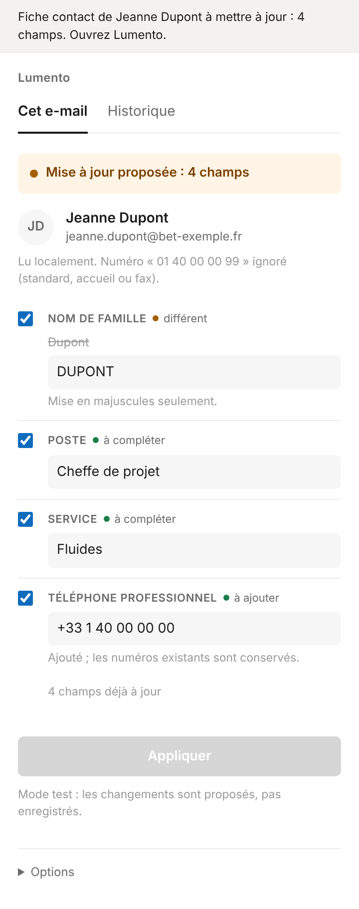
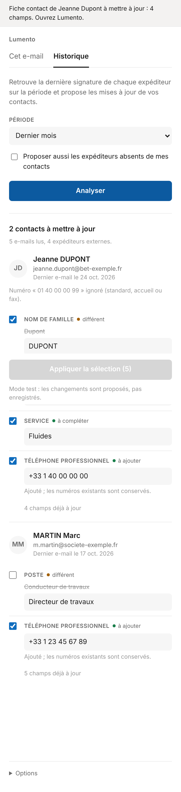

# Lumento

*Vos contacts Outlook tenus à jour par les signatures que vous recevez.*

Complément Outlook qui lit la signature de l'expéditeur d'un e-mail et propose de mettre à jour sa fiche contact : poste, société, service, téléphones, adresse. Rien n'est enregistré sans votre validation.

<p>
  
  
</p>

**Sans serveur et sans abonnement** : le complément est un ensemble de fichiers statiques, publiés gratuitement sur GitHub Pages. La signature est lue directement dans Outlook ; aucune donnée n'est envoyée ailleurs, sauf si vous activez l'option Claude.

## Fonctionnement

1. Sur un e-mail ouvert, cliquez sur **Mettre à jour le contact**.
2. Le volet compare la fiche Outlook de l'expéditeur avec sa signature, champ par champ.
3. Les champs vides sont cochés ; une valeur différente est signalée mais **jamais cochée d'office** ; rien n'est effacé.
4. Vous corrigez si besoin, puis cliquez sur **Appliquer** (ou **Créer le contact** si l'expéditeur est inconnu).

### Quand la lecture se trompe : coller la signature

Sous la fiche, **« La lecture est fausse ? Collez la signature »** : sélectionnez la signature dans l'e-mail, copiez-la, collez-la dans le cadre. Elle est lue aussitôt, telle quelle, et la comparaison se met à jour. Outlook ne donne pas aux compléments accès à la sélection d'un e-mail reçu : le copier-coller est le moyen fiable de désigner la signature.

### Vérification automatique à chaque e-mail

Épinglez le volet (icône punaise en haut du volet) : il reste ouvert et **revérifie chaque e-mail que vous sélectionnez**. Quand une mise à jour est possible :

- une **barre d'alerte** s'affiche dans l'e-mail, sous l'objet : « Fiche contact de … à mettre à jour : 3 champs » ;
- un bandeau orange apparaît en tête du volet, avec le détail des champs.

Une fiche existante est signalée dès qu'un champ diffère ; un expéditeur absent de vos contacts ne l'est que si sa signature est nette, pour ne pas alerter à chaque lettre d'information. Outlook ne permet pas à un complément de se déclencher tout seul à l'ouverture d'un e-mail : sans volet épinglé, la vérification se fait au clic sur **Mettre à jour le contact**.

### Scan de l'historique

L'onglet **Historique** passe en revue les e-mails reçus sur une période au choix (7 jours, 1 mois, 3 mois, 6 mois ou 1 an) :

- pour chaque expéditeur externe, seule sa **signature la plus récente** est retenue ;
- les **listes de diffusion** et lettres d'information sont écartées (en-têtes de liste, liens de désinscription, « X via Liste ») : leurs signatures sont rarement celles de la personne ;
- seuls les contacts dont la fiche peut être complétée ou corrigée sont proposés ;
- les expéditeurs absents de vos contacts ne sont proposés que si vous le demandez, et seulement si leur signature est nette (pour écarter newsletters et notifications) ;
- les contacts défilent **un par un** : vous corrigez si besoin, puis **Appliquer et continuer**, ou **Passer** si la proposition est fausse.

Le scan lit au plus 5 000 e-mails, dans tous les dossiers sauf les courriers indésirables, la corbeille, les brouillons et les éléments envoyés, et peut être arrêté à tout moment. Il utilise toujours la lecture locale : rien ne quitte Outlook.

Règles appliquées :

- Nom de famille et société en MAJUSCULES, prénom avec majuscule initiale.
- Numéros en 06 et 07 classés en mobile, 01 à 05 et 09 en professionnel ; numéros français écrits au format international « +33 6 12 34 56 78 ».
- Un même numéro écrit autrement (« 0612345678 », « +33 6 12 34 56 78 ») est reconnu comme identique.
- Numéros de standard, d'accueil ou de fax ignorés.
- Seul le message de l'expéditeur est lu, pas le fil des réponses : on n'attribue pas la signature d'un tiers.
- Plusieurs fiches pour la même adresse : le volet les liste et signale le doublon.
- Expéditeurs internes et adresses automatiques (noreply@…) ignorés.

## Installation dans votre organisation

Comptez une demi-heure. Il faut être administrateur Microsoft 365 pour l'étape 2.

Le site public ne contient **aucune donnée d'organisation** : chaque organisation crée son propre manifeste, qu'elle garde en privé. Vous pouvez utiliser l'instance publique `https://lumento.github.io/outlook-contact-update` ou publier la vôtre (étape 1, facultative).

### 1. (Facultatif) Publier votre propre instance

1. Faites un *fork* de ce dépôt, puis **Settings**, **Pages**, source **GitHub Actions**.
2. Indiquez son adresse dans `deploy.config.json` (`"host": "https://<compte>.github.io/<dépôt>"`) et envoyez sur `main` : GitHub teste, construit et publie.

Tout autre hébergement HTTPS de fichiers statiques convient aussi : déposez le contenu de `dist/` après `npm run build`.

### 2. Inscrire l'application dans Microsoft Entra ID

1. Centre d'administration Microsoft Entra, **Inscriptions d'applications**, **Nouvelle inscription**. Comptes : *ce répertoire d'organisation uniquement*.
2. **Authentification** : plateforme **Application monopage (SPA)**, avec deux URI de redirection (`<hôte>` étant l'adresse de l'instance) :
   - `brk-multihub://<domaine de l'hôte>` (par exemple `brk-multihub://lumento.github.io`)
   - `<hôte>/auth.html`
3. **Autorisations d'API** : Microsoft Graph, déléguées, **Contacts.ReadWrite** et **Mail.Read** (lecture seule, pour le scan de l'historique). Puis **Accorder un consentement d'administrateur**.
4. Notez l'**ID d'application (client)** et l'**ID de l'annuaire (locataire)**.

### 3. Créer votre manifeste

Ouvrez `<hôte>/manifest.html`, saisissez le nom de l'organisation, les deux identifiants et vos domaines internes (expéditeurs ignorés), puis téléchargez le fichier. Il est construit dans votre navigateur : rien n'est envoyé.

- Laissez décochée l'option d'enregistrement pour un premier essai : le volet propose sans écrire. Regénérez ensuite le manifeste **avec le même identifiant** pour activer l'écriture.
- **Ne publiez pas ce fichier** (ni dans un dépôt public, ni sur un site) : il contient les identifiants de votre organisation.

### 4. Charger le complément dans Outlook

- **Pour vous seul, en test** : Outlook, **Compléments**, **Mes compléments**, **Ajouter un complément personnalisé**, **À partir d'un fichier** (accès direct : `https://aka.ms/olksideload`).
- **Pour l'équipe** : centre d'administration Microsoft 365, **Applications intégrées**, téléversez le manifeste et affectez-le à un groupe. La mise à disposition peut prendre plusieurs heures.

Clients pris en charge : Outlook sur le web, nouvel Outlook et Outlook classique pour Windows, Outlook pour Mac.

## Option : lecture par Claude

La lecture locale est fiable pour les numéros et les adresses ; elle se trompe parfois sur le poste ou la société, que vous corrigez dans le volet. Pour une lecture plus fine, chaque utilisateur peut saisir sa propre clé API Claude dans **Options** :

- seules les 30 dernières lignes du message de l'expéditeur sont envoyées à l'API Claude ;
- la clé reste dans le navigateur de l'utilisateur, l'appel part directement d'Outlook ;
- le coût est à la charge du titulaire de la clé (modèle léger, quelques centimes pour des centaines de signatures ; vérifiez la grille tarifaire en vigueur) ;
- en cas d'échec, le volet revient à la lecture locale.

Pour une équipe, préférez la lecture locale ou une clé par personne : une clé partagée serait visible de tous ceux qui l'ont saisie.

## Confidentialité et sécurité

- **Droits demandés** : lecture de l'e-mail ouvert (`ReadItem`) ; sur Microsoft Graph, `Contacts.ReadWrite`, et `Mail.Read` (lecture seule) demandé seulement au premier scan de l'historique. Le complément n'envoie, ne déplace ni ne supprime aucun e-mail.
- **Aucun serveur** : aucune donnée ne transite par l'auteur du complément ni par GitHub. Les jetons Microsoft ne partent que vers `graph.microsoft.com` (vérifié à chaque requête, liens de pagination compris) et sont gardés en `sessionStorage`.
- **Rien ne s'efface** : seuls les champs cochés sont écrits ; une valeur vidée ou invalide (e-mail, téléphone) est ignorée ; aucun numéro ni adresse n'est retiré ; la fiche est relue juste avant l'écriture, et les limites d'Outlook (3 adresses, 2 téléphones professionnels) sont respectées.
- **E-mails usurpés** : une adresse lue dans une signature, différente de l'adresse d'envoi, est proposée mais jamais cochée d'office. Le scan de l'historique ignore les courriers indésirables et la corbeille.
- **E-mails piégés** : le texte est borné avant analyse (50 000 caractères, lignes de 500) ; tout ce qui vient d'un e-mail est échappé avant affichage.
- **Publication** : les dépendances npm sont installées sans scripts et ne s'exécutent que dans l'étape de construction, qui n'a aucun droit de publication ; les actions GitHub sont figées sur un commit précis.
- **Origine partagée** : sur `<compte>.github.io`, tous les sites GitHub Pages du compte partagent la même origine. Si vous y publiez d'autres sites, ou pour l'option Claude (la clé est gardée dans le navigateur), préférez un domaine dédié (par exemple `outlook.votre-domaine.fr`, configurable dans **Settings › Pages › Custom domain**).

## Développement

```bash
npm ci
npm test         # 68 tests : lecture des signatures, règles, sécurité des écritures, historique
npm run build    # construit dist/ (aucune donnée d'organisation)
```

Mode démonstration, sans Outlook ni connexion : servez `dist/` en local et ouvrez `taskpane.html?demo` (ou `?demo=nouveau` pour un expéditeur inconnu, `?demo=historique` pour le scan).

Les tests n'utilisent que des signatures fictives : n'ajoutez jamais de données de contacts réels, ni d'identifiants d'organisation, au dépôt.

## Limite connue

Outlook n'accepte qu'un numéro mobile par fiche. Si la signature donne un autre mobile, le volet le signale sans le cocher : l'accepter remplace l'ancien.

## Licence

MIT, voir [LICENSE](LICENSE).
